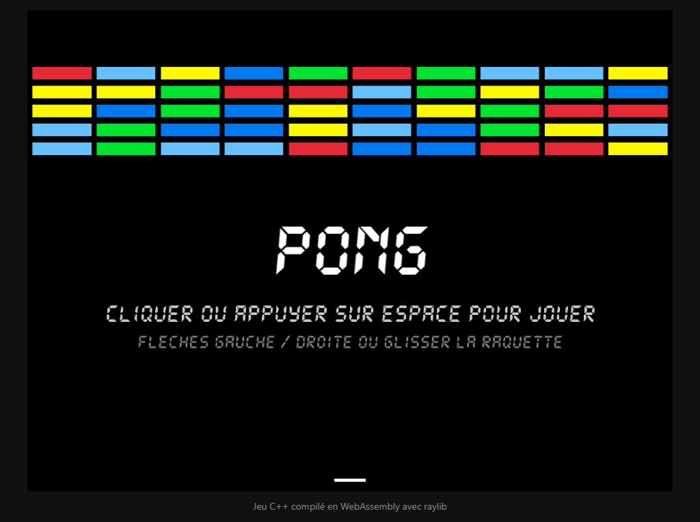
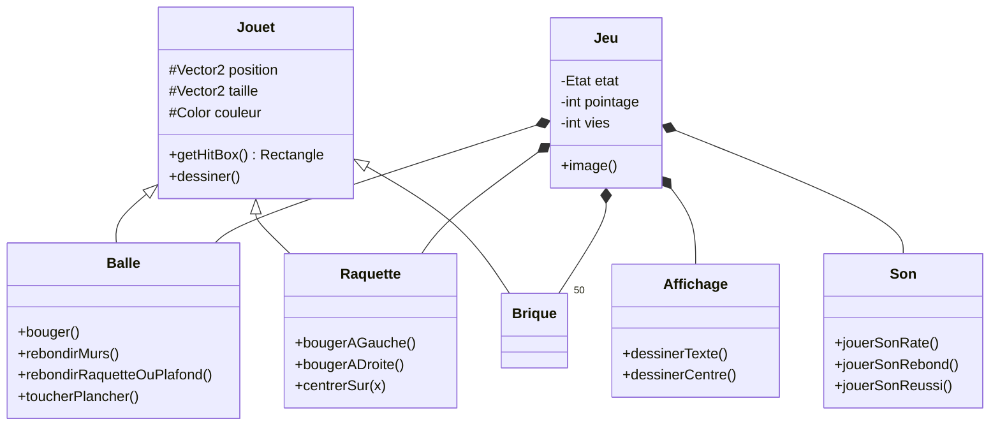
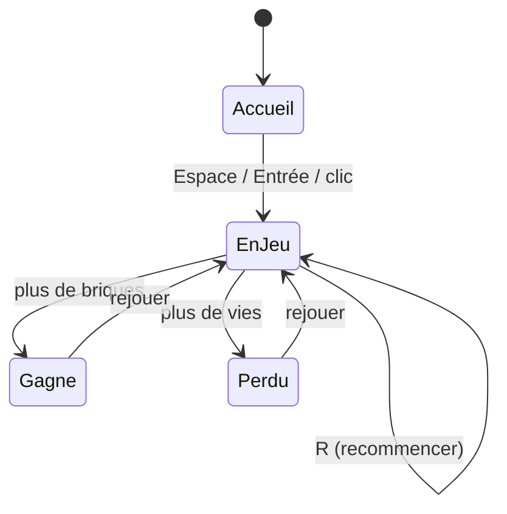

<div align="center">

# Pong — casse-briques en C++

**Un casse-briques en C++17 avec raylib, jouable sur ordinateur et directement dans le navigateur grâce à WebAssembly.**

[](https://nick-suebang.github.io/casse-briques/)

[](https://github.com/Nick-Suebang/casse-briques/actions/workflows/deploy.yml)




</div>

---

## Sommaire

- [Présentation](#présentation)
- [Fonctionnalités](#fonctionnalités)
- [Jouer](#jouer)
- [Règles du jeu](#règles-du-jeu)
- [Compiler le projet](#compiler-le-projet)
- [Architecture](#architecture)
- [Choix techniques](#choix-techniques)
- [Déploiement continu](#déploiement-continu)
- [Configuration du jeu](#configuration-du-jeu)
- [Auteur](#auteur)

## Présentation

Le joueur dirige une raquette pour renvoyer une balle et détruire un mur de briques.
Le projet montre comment **un seul code C++** peut produire :

- un **programme natif** pour Windows, macOS ou Linux ;
- une **version web** compilée en WebAssembly avec Emscripten, publiée automatiquement sur GitHub Pages et jouable en un clic, sans rien installer.

## Fonctionnalités

- 50 briques (5 lignes × 10 colonnes) de couleurs aléatoires
- Raquette pilotable au **clavier** ou à la **souris** (cliquer-glisser)
- Système de **vies** et de **pointage**
- Écrans d'accueil, de victoire et de défaite, avec relance immédiate
- **Effets sonores** pour les rebonds, les briques détruites et les balles perdues
- Police d'affichage numérique (DS-DIGIT)
- Vitesse de jeu **identique sur tous les écrans**, quelle que soit leur fréquence de rafraîchissement

## Jouer

### En ligne

Ouvrez **https://nick-suebang.github.io/casse-briques/** dans un navigateur récent (Chrome, Edge, Firefox ou Safari).

### Contrôles

| Action | Touche / geste |
|---|---|
| Commencer ou rejouer | <kbd>Espace</kbd>, <kbd>Entrée</kbd> ou clic |
| Déplacer la raquette | <kbd>←</kbd> / <kbd>→</kbd> |
| Déplacer la raquette à la souris | Cliquer sur la raquette puis glisser |
| Recommencer la partie | <kbd>R</kbd> |
| Quitter (version ordinateur) | <kbd>Q</kbd> ou fermer la fenêtre |

## Règles du jeu

- La partie commence avec **3 vies**.
- Chaque rebond sur la raquette et chaque brique détruite rapporte **1 point**.
- Quand la balle passe sous la raquette, le joueur perd une vie et la balle repart de sa position de départ.
- La partie est **gagnée** quand toutes les briques sont détruites, et **perdue** quand il ne reste plus de vie.

## Compiler le projet

raylib 5.5 est téléchargé automatiquement par CMake lors de la configuration : aucune installation manuelle n'est nécessaire.

### Version ordinateur

**Prérequis :** un compilateur C++17 (GCC, Clang ou MSVC) et CMake 3.20 ou plus.

```bash
cmake -S . -B build -DCMAKE_BUILD_TYPE=Release
cmake --build build --config Release
```

L'exécutable `pong` est produit dans `build/` (ou `build/Release/` avec Visual Studio), et le dossier `assets/` est copié à côté de lui.

> Sous Linux, raylib a besoin des paquets de développement X11 et OpenGL, par exemple sous Debian/Ubuntu :
> `sudo apt install libx11-dev libxrandr-dev libxinerama-dev libxcursor-dev libxi-dev libgl1-mesa-dev`

### Version web

**Prérequis :** [Emscripten](https://emscripten.org/docs/getting_started/downloads.html) (le workflow utilise la version 7.0.0) et CMake 3.20 ou plus.

```bash
emcmake cmake -S . -B build-web -DCMAKE_BUILD_TYPE=Release
cmake --build build-web
```

La compilation produit quatre fichiers dans `build-web/` :

| Fichier | Contenu |
|---|---|
| `index.html` | Page qui accueille le jeu (générée à partir de `web/shell.html`) |
| `index.js` | Code de liaison entre le navigateur et WebAssembly |
| `index.wasm` | Le jeu compilé |
| `index.data` | La police et les sons, préchargés dans un système de fichiers virtuel |

Pour tester en local, servez ce dossier avec un serveur web (ouvrir `index.html` directement ne fonctionne pas, car le navigateur bloque le chargement de fichiers locaux) :

```bash
python -m http.server 8000 --directory build-web
```

Puis ouvrez http://localhost:8000.

## Architecture

```
.
├── main.cpp                  # Point d'entrée : fenêtre, audio, boucle (native ou navigateur)
├── Jeu.cpp / Jeu.h           # Une partie : états, règles, collisions, rendu
├── Jouet.cpp / Jouet.h       # Classe de base : position, taille, couleur, dessin
├── Balle.cpp / Balle.h       # Mouvement et rebonds de la balle
├── Raquette.cpp / Raquette.h # Déplacement de la raquette, limité au terrain
├── Brique.cpp / Brique.h     # Briques de couleur aléatoire
├── Affichage.cpp / .h        # Rendu du texte avec la police DS-DIGIT
├── Son.cpp / Son.h           # Chargement et lecture des effets sonores
├── Utilitaires/
│   └── Configuration.h       # Constantes du jeu (constexpr)
├── assets/                   # Police et sons
├── web/shell.html            # Gabarit de la page web
├── docs/                     # Images de la documentation
├── .github/workflows/
│   └── deploy.yml            # Compilation WebAssembly et publication sur GitHub Pages
└── CMakeLists.txt            # Compilation native et web
```

### Classes



### États d'une partie



## Choix techniques

- **Une seule boucle de jeu pour deux plateformes.** `Jeu::image()` calcule et dessine une image. Sur ordinateur, `main()` l'appelle dans une boucle classique. Dans le navigateur, qui ne permet pas de boucle bloquante, c'est `emscripten_set_main_loop_arg` qui l'appelle à chaque rafraîchissement de l'écran.
- **Pas de temps fixe.** La simulation avance par pas de 1/400 s, avec un accumulateur de temps. Le jeu tourne donc à la même vitesse sur un écran à 60 Hz ou à 144 Hz. Le retard rattrapé est plafonné à 0,1 s pour éviter un saut de la balle quand l'onglet revient au premier plan.
- **Collisions robustes.**
  - La balle ne rebondit sur un mur que si elle se dirige vers lui, et sur la raquette que si elle descend : elle ne peut donc pas rester coincée.
  - Une seule brique est détruite par pas, pour éviter que deux rebonds simultanés s'annulent et que la balle traverse le mur.
- **Gestion des ressources (RAII).** La police et les sons sont chargés dans les constructeurs d'`Affichage` et de `Son` et libérés dans leurs destructeurs. La copie de ces classes est interdite pour qu'une ressource ne soit jamais libérée deux fois.
- **Constantes à la compilation.** Toutes les dimensions et vitesses sont des `constexpr` regroupées dans `Utilitaires/Configuration.h`.
- **Compilation stricte.** Le code compile avec `-Wall -Wextra -Wpedantic` (ou `/W4` avec MSVC).

## Déploiement continu

Le workflow [`.github/workflows/deploy.yml`](.github/workflows/deploy.yml) se lance à chaque push sur `main` et peut aussi être déclenché à la main depuis l'onglet **Actions**. Il :

1. installe Emscripten 7.0.0 ;
2. compile le jeu en WebAssembly ;
3. rassemble `index.html`, `index.js`, `index.wasm` et `index.data` ;
4. publie le tout sur GitHub Pages.

Pour reproduire ce déploiement sur un autre dépôt, choisissez **GitHub Actions** comme source dans **Settings → Pages**.

## Configuration du jeu

Les principaux réglages se trouvent dans [`Utilitaires/Configuration.h`](Utilitaires/Configuration.h) :

| Constante | Valeur | Rôle |
|---|---|---|
| `LARGEUR_FENETRE` × `HAUTEUR_FENETRE` | 1024 × 764 | Taille de la zone de jeu |
| `PAS_PAR_SECONDE` | 400 | Nombre de pas de simulation par seconde |
| `VIES_DEPART` | 3 | Vies au début d'une partie |
| `NBR_LIGNES_BRIQUE` × `NBR_RANGEES_BRIQUE` | 5 × 10 | Disposition des briques |
| `VITESSE_BALLE` | 1.2 | Déplacement de la balle par pas |
| `VITESSE_RAQUETTE` | 1.3 | Déplacement de la raquette par pas |
| `LARGEUR_RAQUETTE` | 50 | Largeur de la raquette |

Il suffit de modifier une valeur puis de recompiler.

## Auteur et contact

**Nick Suebang** (Nick Hariel Teponno Suebang), technicien en informatique et développeur web et mobile à Rimouski (QC).

- Portfolio : [nicksuebang.com](https://nicksuebang.com)
- Courriel : [contact@nicksuebang.com](mailto:contact@nicksuebang.com)
- GitHub : [@Nick-Suebang](https://github.com/Nick-Suebang)
- LinkedIn : [Nick Hariel Teponno Suebang](https://www.linkedin.com/in/nick-hariel-teponno-suebang-6a8875292/)
